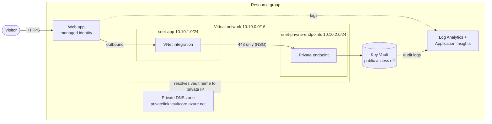

# Secure web app on Azure with Terraform

[](../../actions/workflows/terraform.yml)

A small but production-minded Azure environment, fully defined in Terraform.
A containerised web app reads a secret from Azure Key Vault **without any
password in the code, the pipeline or the Terraform state**, and the Key Vault
is not reachable from the internet.

The goal of this project is not the website itself. It shows how to build
infrastructure the way a platform team would: modular, secure by default,
tested, and deployed through a pipeline.

## Architecture



**How a request for the secret flows**

1. The web app starts and sees the app setting `APP_SECRET`, which is a
   *Key Vault reference* (a pointer, not the value).
2. It asks Entra ID for a token using its **managed identity**. No password involved.
3. It looks up the vault's hostname. The **private DNS zone** answers with a
   private IP address inside the VNet.
4. The request leaves through **snet-app**, passes the **NSG** (only port 443
   from the app subnet is allowed) and arrives at the **private endpoint**.
5. Key Vault checks the role assignment. The identity has
   **Key Vault Secrets User** (read-only), so the secret is returned.
6. The read is written to the **audit log** in Log Analytics.

## What this project demonstrates

| Topic | How it is applied here |
| --- | --- |
| Infrastructure as Code | Everything is Terraform, split into four reusable modules |
| Identity | Managed identity instead of passwords or connection strings |
| Least privilege | The app can only *read* secrets; admins are assigned separately |
| Network security | Private endpoint, private DNS, NSGs, Key Vault firewall on deny |
| Secret handling | The secret value never appears in code, state or Git history |
| Observability | HTTP, console and audit logs flow to one Log Analytics workspace |
| Remote state | State in Azure Storage with locking, versioning and Entra ID auth |
| CI/CD | GitHub Actions: format, validate, test, security scan, plan, apply |
| Passwordless pipeline | GitHub logs in to Azure with OIDC, no stored client secret |
| Testing | `terraform test` checks the security baseline with a mocked provider |

## Repository layout

```
.
├── main.tf                  # Wires the modules together
├── variables.tf             # Inputs, with validation
├── outputs.tf
├── providers.tf / versions.tf / backend.tf
├── environments/dev.tfvars  # Values for the dev environment
├── modules/
│   ├── network/             # VNet, subnets, NSGs
│   ├── monitoring/          # Log Analytics, Application Insights
│   ├── keyvault/            # Key Vault, private endpoint, private DNS
│   └── webapp/              # App Service plan, web app, diagnostics
├── tests/security.tftest.hcl
├── scripts/bootstrap-state.sh
├── docs/design-decisions.md
└── .github/workflows/terraform.yml
```

## Deploying it yourself

**You need:** an Azure subscription, [Azure CLI](https://learn.microsoft.com/cli/azure/install-azure-cli),
[Terraform](https://developer.hashicorp.com/terraform/install) 1.9 or newer.
Your account needs permission to create role assignments (Owner, or
Contributor plus Role Based Access Control Administrator).

```bash
# 1. Log in and select the subscription
az login
export ARM_SUBSCRIPTION_ID="$(az account show --query id -o tsv)"

# 2. One-time: create the storage account for the Terraform state
./scripts/bootstrap-state.sh
cp backend.hcl.example backend.hcl     # then paste the values the script printed

# 3. Deploy
terraform init -backend-config=backend.hcl
terraform plan  -var-file=environments/dev.tfvars
terraform apply -var-file=environments/dev.tfvars
```

After the first `terraform init`, commit the generated `.terraform.lock.hcl`
so everyone uses exactly the same provider versions.

### Setting the secret

The secret value is deliberately not managed by Terraform. To set it, allow
your own IP address and give yourself the admin role in `environments/dev.tfvars`:

```hcl
key_vault_allowed_ips      = ["<your public IP>"]
key_vault_admin_object_ids = ["<az ad signed-in-user show --query id -o tsv>"]
```

Run `terraform apply` again, then:

```bash
az keyvault secret set --vault-name <key_vault_name output> --name app-secret --value "hello"
```

Empty both lists and apply once more to close the vault again. The web app
keeps working, because it uses the private endpoint.

### Cleaning up

```bash
terraform destroy -var-file=environments/dev.tfvars
```

## Cost

Roughly €0.70 per day in West Europe while it is running: the B1 App Service
plan and the private endpoint are the two paid parts. Destroy the environment
when you are done. Prices change, so check the
[Azure pricing calculator](https://azure.microsoft.com/pricing/calculator/).

## Pipeline

| Stage | Trigger | Needs Azure login | What it does |
| --- | --- | --- | --- |
| Validate | Every push and pull request | No | `fmt`, `validate`, `terraform test`, Checkov scan |
| Plan | Pull request to `main` | Yes (OIDC) | Shows what would change |
| Apply | Merge to `main` | Yes (OIDC) | Deploys, optionally after manual approval |

Plan and Apply are skipped until these **repository variables** exist
(Settings → Secrets and variables → Actions → Variables):

| Variable | Value |
| --- | --- |
| `AZURE_CLIENT_ID` | Client ID of an app registration with a federated credential for this repo |
| `AZURE_TENANT_ID` | Your Entra ID tenant ID |
| `AZURE_SUBSCRIPTION_ID` | Your subscription ID |
| `TFSTATE_RESOURCE_GROUP` | Resource group of the state storage account |
| `TFSTATE_STORAGE_ACCOUNT` | Name of the state storage account |

The app registration needs **Contributor** and **Role Based Access Control
Administrator** on the subscription, and **Storage Blob Data Contributor** on
the state storage account. Microsoft's guide:
[Connect GitHub to Azure with OpenID Connect](https://learn.microsoft.com/azure/developer/github/connect-from-azure-openid-connect).

## Tests

```bash
terraform init -backend=false
terraform test
```

The tests plan the configuration against a mocked Azure provider and check,
among other things, that the web app is HTTPS-only with TLS 1.2, that the Key
Vault is private by default, and that the app identity only gets the read-only
role. Nothing is created in Azure and no credentials are needed.

## Design decisions

The reasoning behind the main choices, including what was left out on purpose
and what would change for production, is in
[docs/design-decisions.md](docs/design-decisions.md).
